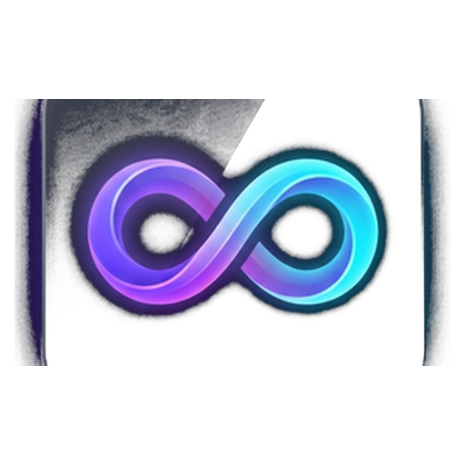

<p align="center">
  
</p>

<h1 align="center">OmniStream Desktop</h1>

<p align="center">
  O app de TV do OmniStream, agora como aplicativo nativo para Linux e Windows.
</p>

A partir da versão 2.0, o OmniStream Desktop deixou de ser o site
empacotado no Electron. Ele passou a ser o mesmo app nativo do
[OmniStream para Android TV](https://github.com/sauliiin/open-Stremio), em Kotlin
e Compose: as mesmas telas, a mesma camada de dados e a mesma navegação, rodando
numa janela de desktop com um player nativo baseado no **mpv**.

## O que vem do app de TV

- Home cinematográfica com Spotlight, autotrailer, temas Normal, Cyberpunk,
  Netflixy e Primefly, e cards que se expandem.
- Biblioteca sincronizada com MDBList, Trakt ou Simkl: listas, watchlist,
  coleção, progresso e "continuar assistindo" com a posição exata.
- Addons compatíveis com o protocolo Stremio, com troca automática de fonte
  quando um link falha.
- Avaliações (IMDb, Rotten Tomatoes, Metacritic, Letterboxd, Trakt), elenco e
  artwork localizada.
- Pular abertura e recap via IntroDB, legendas externas com ajuste de
  sincronia, faixas de áudio e legenda do arquivo.
- Login com Google (sincroniza preferências e addons entre aparelhos), só com
  a chave do MDBList, ou como convidado.
- Interface em português, inglês, espanhol e francês.

## O que é próprio do desktop

- **Player mpv** embutido na janela, com o OSD do app de TV desenhado por cima.
  Toca HLS, DASH e qualquer codec de áudio (DTS, TrueHD, E-AC3) em software,
  com decodificação de vídeo por hardware quando a GPU suporta.
- **Teclado e mouse**: as setas funcionam como o D-pad, Enter confirma e Esc
  volta. O mouse destaca e clica em tudo.
- **Janela de verdade**: tela cheia, instância única (abrir de novo traz a
  janela para a frente), notificação ao terminar um episódio e ícone na
  barra de tarefas.
- **Atualização automática**: o AppImage baixa a versão nova da página de
  Releases e se substitui. No Windows, o instalador novo é baixado e aberto.
- **Integração com o menu de aplicativos**: na primeira execução, o AppImage
  cria a entrada `OmniStream` no menu. Para desativar, defina
  `OMNISTREAM_NO_DESKTOP_ENTRY=1`.

### Atalhos

| Tecla | Ação |
|---|---|
| Setas | Navegar (D-pad); no player, ←/→ avançam ou voltam 10 s |
| Enter / Espaço | Confirmar; no player, play/pause |
| Esc / botão "voltar" do mouse | Voltar |
| F11, Alt+Enter, `F` (no player) ou duplo clique | Tela cheia |
| `M`, `+`/`-`, roda do mouse (no player) | Mudo e volume |
| Ctrl+Q | Sair |

## Instalação

### Linux (AppImage)

1. Instale o **mpv** pelo gerenciador de pacotes, se ainda não tiver. O app usa a
   `libmpv` do sistema:
   - Arch: `sudo pacman -S mpv`
   - Debian/Ubuntu: `sudo apt install libmpv2`
   - Fedora: `sudo dnf install mpv-libs`
2. Baixe `OmniStream-<versão>-x86_64.AppImage` em
   [Releases](https://github.com/sauliiin/openstream-desktop/releases/latest).
3. Torne o arquivo executável (`chmod +x OmniStream-*.AppImage`) e abra-o.

Se a `libmpv` não for encontrada, o app abre normalmente e mostra um aviso
explicando o que instalar.

### Windows

Baixe e execute o instalador `.exe` em
[Releases](https://github.com/sauliiin/openstream-desktop/releases/latest). Ele já
inclui a `libmpv-2.dll`.

## Compilando

Requisitos: **JDK 21** e, para rodar o player, a `libmpv`.

```bash
cp local.properties.example local.properties   # preencha as chaves de API
./gradlew :desktop:run                          # roda o app
./gradlew :desktop:test                         # testes
bash scripts/build-appimage.sh                  # gera release/OmniStream-<versão>-x86_64.AppImage
```

O `build-appimage.sh` usa o `appimagetool` do sistema ou, se ele não existir,
o runtime e o `mksquashfs` que o electron-builder deixa em
`~/.cache/electron-builder`. Por padrão o script não baixa nada. Para que ele
baixe o `appimagetool` do GitHub, use `--download-tools`.

As chaves de API (TMDB, OMDb, fanart.tv, Trakt, Simkl, OpenSubtitles, Wyzie e
Firebase) são lidas de `local.properties`, de propriedades do Gradle ou de
variáveis de ambiente. No GitHub Actions, elas vêm dos *secrets* do repositório
com os mesmos nomes.

### Release

Ao enviar uma tag `vX.Y.Z`, o workflow `.github/workflows/release.yml` gera o
AppImage (Ubuntu) e o instalador `.exe` (Windows) e anexa os dois à Release.
Atualize antes o `appVersion` em `desktop/build.gradle.kts`, que é a versão
que o atualizador automático compara.

```bash
git tag v2.0.0 && git push origin v2.0.0
```

## Login com Google

O seletor de contas do Google abre no navegador do sistema, onde você já está
logado. A página vem de um servidor local em `http://127.0.0.1:47311`, e o
token volta para o app pela mesma porta. Essa origem precisa estar cadastrada
uma única vez em **Authorized JavaScript origins** do OAuth Client
`862741916290-5bhenqt1prf98341g2douaedchkqv3nb` (projeto Firebase
`safevault-fcbdc`). É a mesma origem que a versão Electron já usava, então
quem já fez esse cadastro não precisa repetir.

## Como o código está organizado

```
desktop/
  src/main/kotlin/com/mdblisthub/tv/   código do app de TV (portado)
  src/main/kotlin/com/mdblisthub/desktop/
    Main.kt                 janela, grafo de objetos, tema, escala da UI
    mpv/                    libmpv via JNA: player, renderizador, clipes
    ui/                     teclado/mouse como controle remoto, Dialog/Popup
    GoogleSignInLoopback.kt login com Google pelo navegador
  src/main/kotlin/android/, androidx/, com/google/
                            camada de compatibilidade: as APIs Android que o
                            código de TV usa (Context, Uri, SharedPreferences,
                            BackHandler, tv-material3, Firebase Auth via REST…)
  res/                      res/ do app de TV, sem alterações (+ strings do desktop)
  UPSTREAM_COMMIT           commit do app de TV com o qual o código está alinhado
scripts/
  build-appimage.sh         empacotamento Linux
  sync-upstream.sh          traz mudanças novas do app de TV
```

A interface foi desenhada para uma tela de 960×540 dp. O desktop ajusta a
densidade para a janela ter exatamente esse tamanho em dp, então o app fica
igual ao da TV em qualquer tamanho de janela.

### Atualizando com o app de TV

```bash
bash scripts/sync-upstream.sh            # usa ../open_Stremio/open Stremio
./gradlew :desktop:test :desktop:run
```

O script aplica o diff do app de TV desde o `UPSTREAM_COMMIT` (código Kotlin,
testes e `res/`) com merge de 3 vias, e por isso preserva as adaptações do
desktop. O player e os pedaços de Media3 e WorkManager foram reescritos para
o desktop, então mudanças nessas partes precisam ser portadas à mão.

### Ferramentas de desenvolvimento

- `./gradlew :desktop:snapshot -Pshots="9000:shot:home 9500:key:DOWN 10500:shot:row"`
  roda o app sem janela e salva PNGs em `desktop/build/snapshots/`. Também
  aceita teclas (nomes AWT: `DOWN`, `ENTER`, `ESCAPE`…).
- `./gradlew :desktop:playerProbe -PprobeArgs="out.png <url1> <url2>"` passa o
  `PlaybackController` real por uma cascata de fontes e mostra as fases.

## Licença

Este repositório usa a licença MIT (veja [LICENSE](LICENSE)). O código portado
do app de TV vem de um repositório licenciado sob GPL-3.0.
A `libmpv` é LGPL/GPL e é usada como biblioteca dinâmica do sistema (Linux) ou
distribuída junto com o instalador (Windows).
